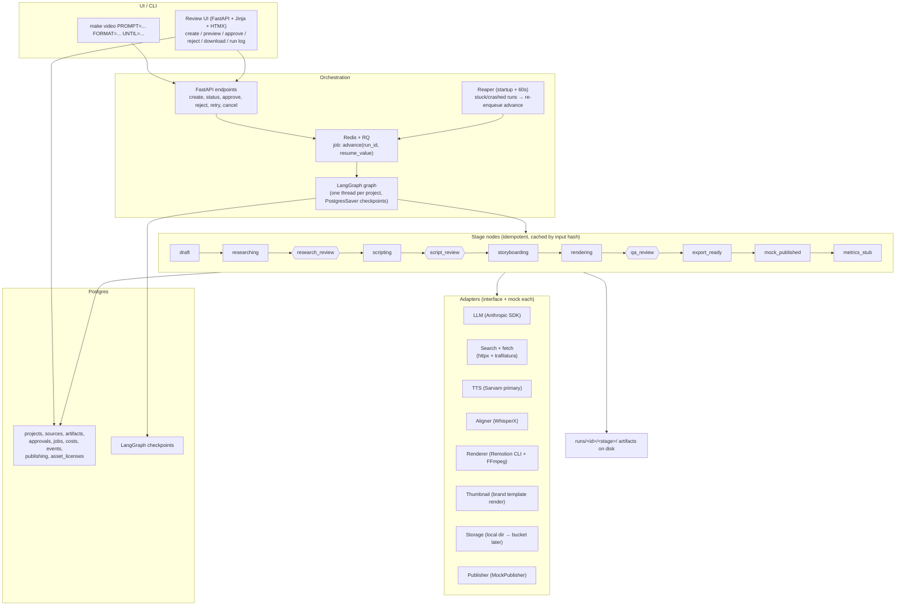

# Ziro YouTube Automation Engine — Architecture

Sandbox proof of concept, production-grade code. One engineer (Dolender) builds it; Hemu reviews at every gate. Source of truth for requirements: `docs/BRIEF.md`. This document is the source of truth for design.

## 1. Core idea

Every video is a **project** (a run) that moves through a fixed set of **stages**. Each stage is a small, idempotent worker: it reads input artifacts, writes output artifacts to `runs/<id>/<stage>/`, and records what it did and what it cost. A LangGraph **graph** owns the state machine and decides what runs next. Three **human gates** pause the run for Hemu's recorded decision. All external services (Claude, search, TTS, alignment, rendering, publishing, storage) sit behind **adapters** with mock implementations, so every one can be swapped or faulted in tests without touching the pipeline.

This one shape delivers the brief's hard requirements: resumability, bounded retries, auditable approvals, a publish step that is impossible to reach without approval, and a cost report generated from data rather than guesswork.

## 2. System diagram



## 3. State machine (brief §05 names)

```
draft → researching → research_review ⏸ → scripting → script_review ⏸
      → storyboarding → rendering → qa_review ⏸ → approved → export_ready
      → mock_published → metrics_stub → DONE

Any stage → failed (retryable flag; after bounded retries → terminal failed, resumable by manual retry)
Any gate: reject → named earlier stage, with required notes
```

Rules:

- Only the graph changes state. Nodes report success/failure; they never route themselves.
- Every transition is a row in `events` (from_state, to_state, actor, timestamp).
- A publish operation cannot be invoked from draft, failed, rejected or unapproved states — enforced in the `Publisher` interface (it accepts only a run whose `qa_review` approval row exists), not by convention.
- Rejection returns to the previous editable artifact: the gate decision names a target stage; downstream artifacts are marked stale; upstream cached stages are never re-paid.

### LangGraph mapping

| Concept | Implementation |
|---|---|
| Project/run | One thread: `thread_id = project_id` |
| Durable state | `PostgresSaver` checkpoint after every node |
| Gate | Gate node calls `interrupt()` (no side effects before it); resume via `Command(resume=decision)` |
| Reject jump | Gate returns `Command(goto=target, update={"review_notes": notes})` |
| Retry | Per-node `RetryPolicy`; retry only `RetryableError` |
| Graph state | Small: `project_id`, `artifacts {stage: path}`, `review_notes`, loop counters, `status` — paths, never blobs |

Verify the installed LangGraph version's API (RetryPolicy / interrupt / Command / PostgresSaver) before use; names have changed between releases.

## 4. Stage contracts

Common contract for every node:

- **Idempotent**: hash of inputs keys a cache; if outputs exist for that hash, reuse and spend nothing. (A crash mid-node re-runs the node; the cache makes that safe and free.)
- **Outputs** to `runs/<id>/<stage>/` via the Storage adapter; registered in `artifacts` with checksum, version, model_or_tool.
- **Costs**: every paid call appends to `costs` (provider, units, unit_price from `config.yaml`, amount).
- **Errors**: raise `RetryableError` (timeout, 429, 5xx) or `FatalError` (validation failure, claim-check failure, missing input). Attempts: research 3, scripting 3, TTS 4, render 2, publish 5 — exponential backoff with jitter. Every attempt is a `jobs` row.

Per stage:

| Stage | Input | Output | Reuses from skill pack |
|---|---|---|---|
| draft | user prompt | `brief.json` (topic, audience, learning outcome, language, duration, format short/long, CTA, brand profile) — Pydantic-validated; all fields must surface in outputs (T01) | — |
| researching | brief | `claims.json` [{id, claim, url, title, quote, accessed_at, verification_status}] — agent loop: search → fetch (httpx/trafilatura) → verify quote appears on page → repeat; unverified claims dropped. The only agentic node. | — |
| research_review ⏸ | claims | per-claim approve/edit/remove; approval row | — |
| scripting | approved claims + voice.md | 5 distinct hooks scored (top 2 kept, all recorded with explanations); `script.md` with `[ON SCREEN]` beats and `[C#]` markers; deterministic claim check (every number/%/date/named result maps to an approved claim; banned-claim scan: salary/placement/testimonial/partnership language; fail → revise, max 2 loops → FAILED); 10 titles linted (top 3); thumbnail text ≤3 words, not repeating title; description; ≤15 tags; 3 target queries; draft chapters. Script shapes enforced: SHORT 45–75 s (hook ≤3 s), LONG 3–5 min (hook+outcome ≤15 s). 150 wpm runtime estimate. Emits versioned `content_package.json`. | yt-script, hooks.json, hookscore.py, yt-package, title.py, yt-seo |
| script_review ⏸ | content_package | approve / reject→(researching\|scripting) with notes | — |
| storyboarding | approved package | `scenes.json` [{id, text, visual_type, asset, duration}] | `[ON SCREEN]` convention |
| rendering | scenes + script | Sarvam TTS (pronunciation dict: "ZAIRO", Indian names) → WhisperX alignment → SRT/VTT → chapters (chapters.py, LLM-rewritten titles; 00:00 first, ≥3, ≥10 s each) → Remotion render (short 1080×1920, burned captions in mobile safe areas; long 1920×1080) → FFmpeg finishing (~ −14 LUFS) → `thumbnail.png` 1280×720 from brand template (no AI image gen). Then automated QA → `qa_report.json` + preview page; failure routes back to the responsible node with reason, max 2 loops. | chapters.py, deadair.py (silence check), yt-shorts (stretch) |
| qa_review ⏸ | preview + qa_report | approve / reject→(storyboarding\|rendering) + required `ai_disclosure` (yes/no + reason) | — |
| export_ready | approved run | download bundle assembled | — |
| mock_published | bundle | `publish_receipt.json` mirroring a real `videos.insert` body (snippet: title/description/tags/categoryId/defaultLanguage; status: privacyStatus "private", selfDeclaredMadeForKids, AI disclosure) + paths, fake video_id, idempotency key = project_id | — |
| metrics_stub | receipt | `metrics.json` shaped like YouTube Analytics `reports.query` (views, estimatedMinutesWatched, averageViewDuration, averageViewPercentage, subscribersGained, audienceWatchRatio), zeroed, source "stub"; `cost_report.json` | — |

Automated QA checks (rendering stage): duration within brief target; loudness; no silence >2 s (deadair.py); subtitle sync; no `[C#]` markers in narration; title <60 chars; chapter rules; thumbnail 1280×720; every claim approved; subtitles clear of CTA overlays.

## 5. The content_package contract

The module boundary between the content half (draft → researching → scripting) and the execution half (storyboarding → rendering → qa → export). One engineer builds both, but the contract keeps each half independently testable against fixtures, and it is the interface Hemu reviews (brief §04).

`content_package.json` (versioned, Pydantic model): brief, approved claims, script, hooks + scores + explanations, titles (all 10 + top 3), thumbnail text, description, tags, target queries, draft chapters.

## 6. Data model (Postgres, Alembic)

From brief §05, extended:

| Table | Fields |
|---|---|
| projects | id, owner, topic, audience, language, format, target_seconds, cta, status, created_at |
| sources | project_id, url, title, accessed_at, claim, verification_status |
| artifacts | project_id, type, version, storage_path, checksum, model_or_tool, created_at |
| approvals | project_id, stage, approver, decision, notes, timestamp, artifact_version, opened_at |
| jobs | project_id, stage, status, retry_count, started_at, finished_at, error_code, cost_estimate |
| publishing | project_id, platform, channel_id, privacy, scheduled_at, provider_video_id, status |
| costs | project_id, stage, provider, units, unit_price, amount, observed_or_estimate |
| events | project_id, from_state, to_state, actor, at |
| asset_licenses | asset, type, source, license, proof_url |

`approvals.opened_at` vs `timestamp` yields manual review minutes for the cost report. Shape `approvals` compatibly with Ziro's approval-contract pattern (brief §02) for future integration — but never connect to any Ziro database. LangGraph checkpoints are not the audit log; these tables are.

## 7. Execution & reliability

- API never runs the graph inline. RQ job `advance(project_id, resume_value=None)` invokes the graph to the next interrupt or END. Job id `project_id:stage:attempt` → duplicate clicks collapse to one job.
- Workers heartbeat. Reaper (startup + every 60 s): runs not finished, not at a gate, no progress past per-stage deadline → log + re-enqueue `advance`. Resume restarts at the last completed node; the cache prevents re-paying completed work.
- The brief's six failure simulations map to fault-injection tests: missing OAuth token (no upload attempt, clear warning); rate limit (bounded backoff, no duplicate); renderer timeout (failed job, artifacts retained, manual retry); rejected script (never renders); duplicate publish click (one idempotent task); unsourced claim (blocks approval, decision retained).

## 8. Review UI

FastAPI + Jinja + HTMX. Three gate screens:

1. **research_review** — each claim beside its clickable source URL and quote; approve/edit/remove per claim.
2. **script_review** — script, 5 hooks with scores, title options, full package.
3. **qa_review** — video player, thumbnail, metadata, qa_report, required AI-disclosure field.

All gates: approve, or reject with target stage + required notes. Plus: run log and state timeline per project; download bundle.

## 9. Security & compliance

- Secrets only via env vars; `.env.example` lists names only. No credentials in code, logs, screenshots or tickets (T12).
- No MCP connections in this project for now (sandbox decision); Supabase/GitHub MCP documented as future options.
- No Ziro production access of any kind. Storage: local folder (or separate sandbox bucket), never Ziro student data.
- Content guardrails enforced in code: banned-claim scan (salaries, placements, testimonials, partnerships, certifications, metrics); claim ledger traceability (T03); supplied brand assets only — never redraw the logo; genuine screen captures only; asset-license ledger table.
- AI disclosure recorded at qa_review per YouTube synthetic-media policy; mock receipt carries it. README notes that real uploads need OAuth (authorization-code flow, CSRF state, minimum scopes) and that unaudited API projects are restricted to private uploads.

## 10. Costs

Every paid call writes a `costs` row at call time. `reports/costs.md` is generated from the table: LLM tokens/requests, voice characters/minutes, render minutes + machine type, image requests, storage size, network egress, YouTube API usage (0, mocked), manual review minutes (from approvals timestamps), total per video — each line marked observed vs estimate, with the price page checked. Claude pipeline calls are API-billed separately from Claude Pro seats; unit prices and a spend cap live in `config.yaml`.

## 11. Testing

Tests never call paid APIs (mock adapters + respx). `tests/` maps 1:1 to the brief:

- **T01–T12** named test modules (brief §09).
- **Fault suite**: the six failure simulations (§7 above).
- **Graph suite**: stub run passes draft → all three gates → metrics_stub; worker killed mid-node resumes via reaper without re-running completed nodes; publish unreachable without approval (type-level); reject re-runs downstream only.
- **Golden suite**: one fixed topic with mock adapters, outputs compared.
- **T10 portability**: CI job performs a fresh install from README + `.env.example`.

## 12. Repository layout

```
ziro-youtube-automation-poc/
  README.md            setup, one-command run, limitations, AI-disclosure note, licenses
  CLAUDE.md            rules for Claude Code sessions
  docs/BRIEF.md        the assignment (source of truth)
  architecture/        this file, decisions.md, REUSE.md, diagrams
  src/
    app/{api,ui,graph,nodes,adapters,core,jobs}
    vendor/youtube-agent-skill/     all 11 skill folders, pinned a2feb21, unmodified
    voice/voice.md                  installed to ~/.claude/youtube/ by make install-voice
    config.yaml
  templates/           Remotion project: Ziro brand (supplied assets only), long/short/thumbnail
  tests/               unit, graph, faults, golden, manual_qa/
  outputs/demo-short/  outputs/demo-long/  outputs/second-topic/
  reports/             costs.md, metrics.md, workboard.md, sign-off.md (from approvals table)
  .env.example
runs/                  git-ignored working artifacts
```

## 13. Tech stack (pinned)

Python 3.12 · FastAPI + Pydantic v2 · LangGraph + PostgresSaver · Postgres + SQLAlchemy 2 + Alembic · Redis + RQ · tenacity · Anthropic Python SDK (direct; no LangChain wrappers) · httpx + trafilatura · Sarvam TTS (adapter; ElevenLabs optional) · WhisperX · Remotion (TypeScript, CLI) + FFmpeg · Jinja + HTMX · structlog · pytest + respx · uv, ruff, mypy · Docker Compose (api, worker, postgres, redis) · GitHub Actions.

## 14. Agent census

One true agent: the research node (search → fetch → verify loop; path unknowable in advance). Four LLM-powered workflow steps: draft, scripting, storyboarding, chapter-title rewrite. Everything else is deterministic code or a human gate. This split is deliberate: determinism where testability and cost control matter, agency only where the path cannot be fixed.

## 15. Build phases

1. **Skeleton + orchestration** — full graph with stub nodes, 3 gates, retries, advance job, reaper, API, logging, cost recording, content_package contract. Exit: stub run end-to-end; fault tests pass on stubs. (Gate A/D groundwork)
2. **Content engine** — research agent, claim ledger, scripting with hookscore/title.py, claim check + banned-claim scan, voice.md draft. (Gate B)
3. **Review UI** — three gates, run log, downloads.
4. **Audio** — Sarvam, pronunciation dict, WhisperX, SRT/VTT, chapters.
5. **Video** — Remotion brand templates (brand assets supplied first), FFmpeg, thumbnail, automated QA. (Gate C)
6. **Delivery** — mock publish, metrics stub, cost report, exports, README, REUSE.md, demo script. (Gate E)

Stretch: Shorts-from-long (yt-shorts), Hindi/Telugu via Sarvam (hookscore/title.py are English-only), sandbox YouTube OAuth adapter.
