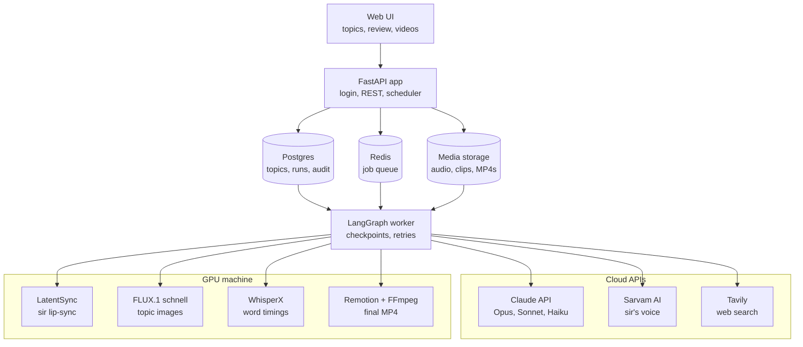
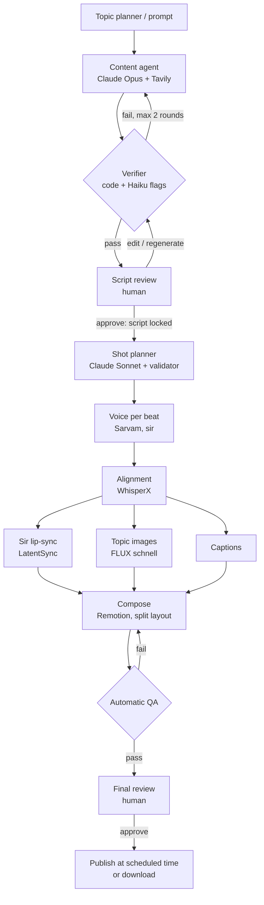

# Ziro AI Content Studio — Architecture (v2)

Branch: `v2-content-studio` · Status: design locked for prototype · Owner: Dolender

---

## 1. Purpose

Turn scheduled learning topics (AI, GenAI, Agentic AI, LLMs, RAG, Data Science, ML, or anything on request) into publish-ready educational videos for YouTube Shorts and Instagram Reels (9:16), and later short YouTube videos (16:9), **explained by sir's AI avatar in his own cloned voice**.

Every factual line is verified against a real source. A human approves the script and the final video. Manual effort per video should be a few minutes of review.

## 2. Constraints

| Constraint | What it means for the design |
|---|---|
| Resources are Claude-only ($500/month API credits + ~$1,000 existing, Claude Code, Skills) | Claude does all text work. Don't optimise Claude cost; optimise quality. |
| Sarvam credits | Voice is Sarvam (sir's cloned voice). |
| No paid GPU budget yet | All GPU work (lip-sync, images) sits behind one swappable GPU worker: own PC or rented. |
| Independent of the Ziro platform | Own UI, own login, own database. No shared users or services. |
| No unnecessary infrastructure | Prototype runs on one machine with Docker Compose. |
| Reuse v1 | Keep the tested v1 modules (orchestration, guardrails, Remotion, captures, CI). |

## 3. System overview

### Components

| Component | Tech | Responsibility |
|---|---|---|
| Web UI | Jinja2 + HTMX (from v1) | Login, topic planner, run timeline, script review, video review, download |
| API | FastAPI + Pydantic v2, Python 3.12 | REST, auth, serves UI, hosts the scheduler |
| Scheduler | APScheduler inside the API process | Starts runs at their trigger time |
| Database | Postgres + SQLAlchemy + Alembic | All state, audit trail, costs |
| Queue | Redis + RQ + reaper (from v1) | Background jobs, retries, orphan recovery |
| Worker | LangGraph + PostgresSaver (from v1) | Runs the pipeline as a checkpointed state machine |
| Media storage | Local disk, hash-keyed folders | Every generated file; unchanged inputs are never regenerated |
| GPU worker | Separate queue `gpu` | LatentSync, FLUX, WhisperX. Same code on own PC or rented GPU |

## 4. Pipeline

### Stage contracts

| # | Stage | Input | Output | Tool | Fails when |
|---|---|---|---|---|---|
| 1 | Trigger | Topic row or prompt | `run` created | Scheduler / UI | — |
| 2 | Content agent | Topic, keywords, guidelines, format | `claims[]` + `beats[]` (JSON), titles, description, hashtags | Claude Opus + Tavily | No 2 mechanism claims on "what/how/explain" topics |
| 3 | Verifier | claims + beats | pass, or list of broken beats | Code + Claude Haiku | Any rule in §7 broken |
| 4 | Script review | Script beside sources and flags | Approved, locked script version | Human | Rejected → regenerate |
| 5 | Shot planner | Locked beats | `shots[]`: layout, on-screen words, image prompt | Claude Sonnet + validator | Layout rules in §8 broken |
| 6 | Voice | Beats | One WAV per beat, −14 LUFS | Sarvam (sir's voice ID) | API error → retry |
| 7 | Alignment | Beat audio + known text | Word timings | WhisperX (forced alignment) | Drift > 100 ms |
| 8a | Lip-sync | Sir base clip + beat audio (sir beats only) | Talking-sir clips | LatentSync | Sync score low → re-render, max 2 |
| 8b | Images | Image prompts | PNG per shot, 1080 px+ | FLUX.1 schnell | Safety filter fails → regenerate |
| 8c | Captions | Word timings | Caption track | Code | — |
| 9 | Compose | Shots, clips, images, audio, captions | MP4 | Remotion + FFmpeg | Render error → retry |
| 10 | Automatic QA | MP4 | pass/fail report | Code | Any check in §9 fails |
| 11 | Final review | MP4 + metadata | Approval | Human | Reject → named stage with notes |
| 12 | Publish | Approved MP4 | Upload receipt or download | YouTube API (phase 2), download (prototype) | No approval → refused in code |

Every stage is a LangGraph node with a checkpoint. A crash resumes at the last finished stage. Every output is stored under a hash of its inputs, so editing one beat re-renders only that beat.

## 5. Model routing

| Job | Model | Why |
|---|---|---|
| Research + script | Claude Opus | Best writing; credits allow it |
| Support check (line says more than its source?) | Claude Haiku | Fast, cheap; **flags only, never approves** |
| Shot planner + image prompts | Claude Sonnet | Structured output, good judgement |
| Titles, description, hashtags | Claude Sonnet | Part of the content agent output |
| Fallback writer | Gemini / Groq (v1 adapters) | Only if Claude is down |

Prompts with fixed content (brand rules, style guide, banned words) use prompt caching. All Claude calls return structured JSON validated by Pydantic.

## 6. Data model

| Table | Key fields |
|---|---|
| `users` | id, email, password_hash, role (admin / reviewer) |
| `topics` | id, publish_at, topic, keywords[], guidelines, format (short / video), status |
| `runs` | id, topic_id, stage, status, started_at, finished_at |
| `scripts` | id, run_id, version, beats JSON, locked, edited_by |
| `claims` | id, run_id, kind (definition / mechanism / other), url, quote, verified |
| `shots` | id, run_id, beat_no, layout, on_screen, image_prompt |
| `assets` | id, run_id, type, path, input_hash, license_note |
| `approvals` | id, run_id, gate (script / final), user_id, decision, notes, at |
| `costs` | id, run_id, service, units, usd |
| `consent` | id, person, voice_id, base_clip_path, signed_at, document_path |

## 7. Guardrails (all deterministic code unless marked)

| Check | Rule |
|---|---|
| Quote verification | Each claim's quote (8+ words) appears word-for-word on the page our code fetched |
| Uncited-line detector | Every factual sentence carries a claim ID |
| Support check (Haiku, flag only) | A cited line must not say more than its quote |
| Mechanism rule | "What / how / explain" topics need 2+ verified mechanism claims |
| Banned words | Salary, placements, guarantees, testimonials, partnerships |
| Outcome / hype words | "better", "boost", "instantly", "#1", "real-time"… refused unless an approved claim uses them |
| Screen–voice match | Every word on screen is spoken (alias: Zyro ↔ Ziro) |
| Hook and length | Hook is a top-2 scored hook; Shorts 150–200 words, videos 300–400, ±15% |
| Image rules | Illustration style; no real faces except sir; no logos; no text in images; no fake screenshots or UI |
| Presenter | Only sir's face; avatar stage refuses to run without a `consent` row |
| Publish lock | Publish impossible without final-review approval |
| Budget caps | Max tokens per run, max spend per day (Claude, Sarvam) |
| Secret scanner | CI fails on any key pattern in tracked files |

## 8. Visual spec

### Short layout (1080×1920, 30 fps)

| Time | Layout |
|---|---|
| 0–2 s | Sir full-screen, hook |
| Body | Split: **top ~60%** content (image, diagram, key words, source proof), **bottom ~40%** sir explaining |
| Captions | On the dividing line, current word highlighted |
| End | Sir full-screen CTA → Ziro end card |

### Shot types

Sir full · split (default) · diagram · source proof (real page, quote highlighted) · stat/text pop · topic image · screen demo (phase 2).

### Rules

- Shorts: sir visible ≤ ~40% of non-split time, a visual change every 2–3 s.
- Videos (16:9, phase 2): a visual change every 4–6 s, chapter cards between sections.
- Brand colours and fonts from ziro.digital, defined once in the Remotion theme.

## 9. Media and QA specs

| Item | Spec |
|---|---|
| Video | H.264, 1080×1920 (Shorts/Reels) or 1920×1080 (videos), 30 fps |
| Audio | AAC 48 kHz, −14 LUFS integrated, peaks ≤ −1 dBTP |
| Automatic QA | Loudness in range · no black/frozen frames > 0.5 s · caption drift < 100 ms · lip-sync score above threshold · duration within target |
| Disclosure | AI label in description; YouTube synthetic-content flag on upload |

## 10. Scheduler

- Topic planner rows hold `publish_at`.
- The scheduler starts each run **3 hours before** `publish_at`, leaving time for both reviews.
- If a review isn't done by `publish_at`, the video does **not** publish; the run stays waiting and the reviewer is notified.
- Manual "run now" from the UI or the prompt box uses the same pipeline.

## 11. Security

- UI login (email + password, hashed); roles: admin, reviewer.
- All API keys only in `.env` on the server. `.env.example` holds empty lines only.
- Sir's base clip, voice ID and consent document are readable only by the worker and admins.
- Every approval stores who, when, and notes.

## 12. Deployment (prototype)

One machine with an NVIDIA GPU (12 GB+ VRAM), Docker Compose:

| Service | Runs |
|---|---|
| `api` | FastAPI + UI + scheduler |
| `worker` | LangGraph pipeline (CPU stages, cloud calls) |
| `gpu-worker` | LatentSync, FLUX, WhisperX |
| `render` | Remotion + FFmpeg |
| `postgres`, `redis` | Data and queue |

If there's no local GPU, `gpu-worker` runs on a rented GPU and pulls jobs from the same Redis queue.

## 13. Cost per video (estimate)

| | Short (60 s) | Video (5 min) |
|---|---|---|
| Claude | ~$0.30–0.60 (from credits) | ~$1–2 (from credits) |
| Sarvam | ~₹3 (from credits) | ~₹14 (from credits) |
| GPU | ₹0 own PC / ~₹10–25 rented | ₹0 / ~₹30–60 rented |

$500/month covers far more videos than the channel will publish.

## 14. v1 → v2

| Keep from v1 | Replace | New |
|---|---|---|
| FastAPI + HTMX UI, Postgres, Redis + reaper, LangGraph checkpoints, quote verifier, word checks, hook scoring, Remotion templates, Chrome source captures, WhisperX, CI + secret scanner, 135 tests | Gemini/Groq → Claude · Kokoro → Sarvam · Pixabay → FLUX · 3 gates → 2 | Login · topic planner · scheduler · uncited-line detector · support check · shot planner · LatentSync · split layout · automatic QA · Claude metadata |

## 15. Prototype scope and build order

1. Claude writer (content agent on Opus) + uncited-line detector
2. Support check (Haiku)
3. Sarvam voice per beat, sir's voice
4. Login + topic planner + scheduler
5. GPU worker: FLUX images, LatentSync (test on sir's clip early, in parallel)
6. Shot planner + split layout template
7. Two review steps + download

**Prototype done when:** a topic added in the planner turns into a split-layout Short with sir's face and voice, verified script, topic images and captions, approved and downloadable, without anyone touching code.

## 16. Open decisions

| Decision | Owner |
|---|---|
| GPU machine (own PC + card model, or rent) | Team |
| Remotion commercial licence | Founder |
| Languages beyond English | Sir |
| Auto-publish after approval (phase 2) | Sir |

## 17. Risks

| Risk | Mitigation |
|---|---|
| Lip-sync looks "off" | Keep sir's on-screen time short, sync scoring + re-render, real hook clips recorded by sir |
| No GPU | Rented GPU behind the same queue |
| Generic-looking visuals | One Ziro design system in Remotion; illustration style for images |
| A wrong fact slips through | Code checks + Haiku flags + two human reviews |
| Credits run out | Daily spend caps, cost table per run |